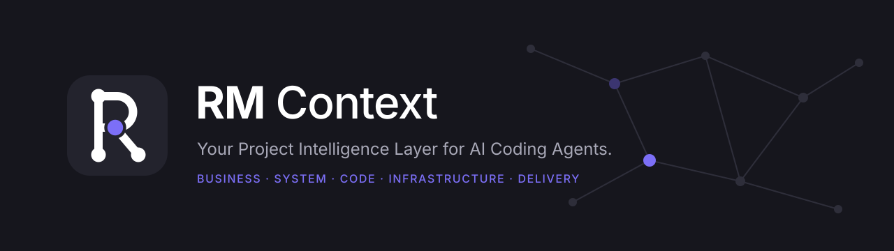

<div align="center">



**RM Context** · by [RM Template](https://rmtemplate.com)

*Your Project Intelligence Layer for AI Coding Agents.*

[](https://rmtemplate.com)
[](CHANGELOG.md)
[](#standalone-cli)
[](docs/integrations/CLAUDE_CODE.md)
[](LICENSE)

</div>

## Introduction

RM Context is a project intelligence toolkit for AI coding agents. It scans your repository into a knowledge base that lives in the repository itself (`.rmcontext/`). From there it provides:
- a knowledge graph backed by source evidence
- professional documents
- delivery plans
- an offline viewer

The core is a dependency-free Node.js CLI that works with any editor or agent. Platform integrations add specialised agents, automatic agent routing and adaptive model routing on top. **Claude Code is the integration available today**; others are planned (see [Supported AI platforms](#supported-ai-platforms)).

## Why RM Context?

- **Agents forget; repositories don't.** Knowledge about the project is kept in versioned files instead of being rediscovered every session.
- **Claims carry evidence.** Every fact in the graph points to a file and line, with a confidence of `verified`, `inferred` or `manual`.
- **One shared model of the project.** Requirements, design, code, infrastructure and plan are linked, so you can trace a business requirement to the code, tests and tasks behind it, and see what a change affects.
- **Cost-aware.** Each delegated task gets the smallest model tier that can do it well.

## Core capabilities

| Area | What you get |
|---|---|
| Scanning | Incremental scan, stack detection, routes, schemas, imports, dependencies, containers and pipelines, with secret exclusion |
| Knowledge graph | 38 node types across business, system, engineering, infrastructure and project layers; 12 relationship types; impact analysis; traceability |
| Documents | 49 templates with validation, versions, an approval gate, and HTML, PDF and DOCX export |
| Project management | Plan validation, Gantt chart, critical path, WBS, roadmap, progress based on evidence, health report |
| Viewer | Offline single-file project viewer: overview, file explorer, code, API and database explorers, eight graph views for large graphs |
| Automatic context | Claude Code hooks add a compact project summary per session, relevant knowledge per prompt, and one incremental refresh per turn |
| Routing | Task category → default agent and model tier, with escalation and metrics |

## Supported AI platforms

| Platform | Status | Details |
|---|---|---|
| Any terminal (core CLI) | **Supported** | [CLI usage](#cli-usage) |
| Claude Code | **Supported** | [docs/integrations/CLAUDE_CODE.md](docs/integrations/CLAUDE_CODE.md) |
| OpenAI Codex | **Planned** adapter · experimental manual setup | [docs/integrations/CODEX.md](docs/integrations/CODEX.md) |
| OpenCode | **Planned** adapter · experimental manual setup | [docs/integrations/OPENCODE.md](docs/integrations/OPENCODE.md) |
| Cursor | **Planned** adapter · experimental manual setup | [docs/integrations/CURSOR.md](docs/integrations/CURSOR.md) |

The full breakdown is in the [compatibility matrix](#compatibility-matrix).

## Architecture overview

```
RM Context Core  (platform-independent)
  CLI · Scanner · Context store · Knowledge graph · Document engine · Plan & Gantt · Task classifier · Model router
        ▲ shell calls
Platform adapters  (platform-specific)
  Claude Code (supported) · Codex · OpenCode · Cursor (planned)
  agents · commands · model selection · hooks · permissions
```

Business logic lives in the core. Adapters translate a platform's agent invocation and model selection into the shared workflow. See [docs/INTEGRATION_ARCHITECTURE.md](docs/INTEGRATION_ARCHITECTURE.md).

## Professional AI teams

*Requires a platform adapter: currently Claude Code.*

| Agent | Delivers |
|---|---|
| Business Analyst | BRD, FSD, SIPOC, process flows, stakeholder analysis, use cases, user stories, acceptance criteria, business rules, gap analysis |
| System Analyst | SRS, system design, UML, ERD, API spec, data dictionary, integration spec |
| Project Manager | Charter, WBS, Gantt, roadmap, sprint plan, RAID, RACI, status report, release plan |
| Senior Engineer | Technical design, ADR, implementation plan, implementation, code review, refactoring, tech debt, test strategy |
| DevOps Engineer | Infrastructure design, deployment, CI/CD, environment matrix, runbook, backup and recovery, monitoring, security and rollback |
| Architecture · QA · Documentation · Quick Q&A | Repository analysis, independent verification, document upkeep, quick lookups |

**How the agents work together:**
- They share IDs (`BR-001` → `SR-001` → `api:POST /users` → `T-004`) and pass structured hand-offs.
- Every unverified statement is labelled **Confirmed**, **Assumption**, **Open Question** or **Recommendation**.
- No agent can approve a document.

## Automatic agent routing

*Requires a platform adapter: currently Claude Code.*

The agent is picked from the work being done:
- **Role commands** go to their role: `/rmc:fsd` goes to the Business Analyst.
- **Templates** go to their owner: `/rmc:document <type>` routes by the template catalog.
- **Workflows** route each step to its role: `discover`, `feature`, `assess`.
- **Task categories** have a default agent: `rmc route --category <c>`.

## Adaptive model routing

Choosing the agent and choosing the model are separate decisions. The CLI picks a tier from the task category and its complexity signals:

| Request | Agent | Model |
|---|---|---|
| "Generate an FSD for a booking feature" | Business Analyst | Sonnet (medium) |
| "Where are users created?" | Quick Q&A | Haiku (low) |
| "Implement a complex payment gateway" | Senior Engineer | Opus (high) |

```bash
rmc route --category fsd
rmc route --category complex-feature --signals security,code,modules:3
rmc route categories            # categories, tiers and signals
```

- **Complexity signals:**
  - `security`, `architecture`, `irreversible`, `debugging`, `cross-module` and `modules:3`+ raise the task to **high**.
  - `ambiguous`, `code` and `modules:2` keep it at least **medium**.
  - `trivial` or `retrieval` lower it to **low**, unless a high signal is present.
- **Precedence:**
  1. The user's explicit `--model`.
  2. The project override `.rmcontext/config.json` → `models.<agent>`.
  3. The agent override `config/models.json` → `agents.<agent>.override`.
  4. The adaptive tier.
  5. The agent default.

  Unsupported values fall back to `routing.fallbackTier`.
- **Escalation.** `rmc route --escalate <R-id> --reason "…" --handoff <H-id>` moves one subtask up a tier, at most `maxEscalations` times, and carries the previous agent's hand-off forward so the work isn't repeated.
- **Metrics.** `rmc route stats` reports routes by tier, agent and category, plus escalations, context reuse and agents per workflow. It also separates suggestions generated, followed, ignored (direct response) and outcome unknown; delegations through `rmc route` versus direct agent calls; actual model verified versus unavailable; foreground runs; and rejected background or concurrent calls. A **Routing efficiency** block adds actual token usage, estimated cost and the direct-vs-delegated comparison (see below). A metric with no telemetry shows as `unavailable`, not an estimate. Only metadata is stored; never prompts or code.

### Routing suggestions for ordinary prompts (Claude Code)

Slash commands always route. Ordinary prompts get a **suggestion** — a deterministic recommendation that Claude may follow or ignore:
- **When.** In an initialized project, the `UserPromptSubmit` hook classifies each prompt with keyword rules (English and Indonesian, no model call). The classifier maps the prompt to a task category and complexity signals, and the existing `rmc route` resolver picks the agent and model with the usual precedence. Greetings, general-knowledge questions, simple lookups ("where is X?") and prompts without a project reference get no suggestion. A suggestion is also skipped below `routing.suggestMinConfidence` (default `0.7`), where an intent alone scores 0.5, a project reference adds 0.3, and knowledge hits add up to 0.2.
- **What Claude sees.** One line of about 50 tokens, such as `RM Context suggests Quick QA (Haiku) for this codebase search and retrieval. To delegate: rmc route --suggested --session-model <id>, show its Notice, run it in the foreground. Simple? Answer directly.` The session summary carries a short policy: suggestions are advice, simple lookups are answered directly, and Claude does not claim a delegation it did not make.
- **Reuse.** `rmc route --suggested` reuses the classification made for the current prompt. The SessionStart hook exports `RMC_SESSION_ID` to Bash for this. The classification is kept only for the same session, the same project and the current prompt, and expires after 30 minutes. A new prompt or Stop ends it, so an earlier prompt's classification is never reused. Without a current suggestion, give `--category` explicitly.
- **What it does not do.** The hook never calls the Agent tool, never blocks a prompt or tool, and never changes the main session model. Whether to delegate is always Claude's decision. Set `"routing": { "autoSuggest": false }` in `.rmcontext/config.json` to turn suggestions and the policy line off.

### Foreground delegation and switch notices (Claude Code)

Delegation is synchronous and visible:
- **Foreground, one agent at a time.** RM Context agents run in the foreground and the main session waits for the result. Roles run one after another, never in parallel, unless the user explicitly asks for it. A `PreToolUse` hook enforces this: it denies an `rmc:*` agent call with `run_in_background`, and a second `rmc:*` agent while one is still running. To allow background or parallel agents for a project, set `"delegation": { "background": "allow" }` in `.rmcontext/config.json`. Other plugins' agents are not affected.
- **Notice before a switch.** `rmc route --session-model <main session model>` prints a `Notice:` line that the main session shows before delegating, such as `Perpindahan ke model Haiku, karena bertugas sebagai Quick QA.` If the subagent model is the same as the main session's, it says so instead (`… sama dengan model sesi utama (tidak ada perpindahan model)`). Nothing is shown when the main session does the work itself. Set `routing.noticeLanguage` to `en` for English notices (`Switching to Haiku, acting as Quick QA.` / `Delegating to Senior Engineer with Sonnet, same as the main session model.`).
- **The model that actually ran.** The notice states what is requested. After the agent returns, a `PostToolUse` hook reads the subagent's own transcript and gives the main session the model recorded on each of its turns and Claude Code's `requestShape` (foreground or background). The main session reports that. When the transcript cannot be read, it reports `Delegation started; actual model not yet verified.` rather than repeating the configured one. Each delegation is logged as metadata (agent, requested model, actual model, mode, token usage, duration, correlation ids) in `.rmcontext/state/autocontext.jsonl`, never the prompt.

### Routing cost and token efficiency (Claude Code)

`rmc route usage`, `rmc route cost` and `rmc route report` show whether delegating to a cheaper model actually saved anything:
- **Actual usage only.** The hooks read token usage from Claude Code's own transcripts: input, output, 5-minute and 1-hour cache writes, cache reads, the actual model id, speed and inference geo. Each API call is counted once (Claude Code repeats its usage on every content-block line). Usage is never estimated from text length. If a transcript cannot be read, the figure is `unavailable`.
- **Main session vs subagents.**
  - The prompt hook records where the main transcript ends. The Stop hook sums the API calls after that point, so main-session usage is **per prompt**.
  - Each delegation's usage is read from that subagent's own transcript and joined to the prompt by its id. Subagent tokens never appear in the main slice, so nothing is counted twice.
  - The main-session calls that issued the delegation (the Agent call, `rmc route`) are reported as delegation overhead. They are already included in the main-session total.
  - If a prompt's starting point is unknown, the usage is labelled `session-level` and never presented as one task's cost.
  - Claude Code's `totalTokens` for an agent is the size of its *last* call, not its total, so it is not used.
- **Pricing registry.** `config/pricing.json` lists USD prices per million tokens for each exact model id: input, output, both cache-write durations and cache reads, with provider, currency, effective date, source and pricing version. Haiku 5.5 prompts over 100,000 tokens, fast mode and US-only inference use their own documented rates. Historical usage is priced with the record in force on its date. A model without a price, such as a partner-platform id, keeps its token counts and shows cost `unavailable`. Costs are **estimates at Anthropic API list prices**; a Claude subscription plan is billed differently.
- **Direct vs delegated.** Savings = direct cost − delegated total cost, where delegated total = main session (including delegation overhead) + subagents. Verified savings come only from controlled benchmarks (below). `rmc route report` also shows an **observational estimate** from ordinary prompts with a routing suggestion, grouped by category: it needs at least 3 direct and 3 delegated prompts per group, and it is never presented as savings or used for a recommendation. RM Context never re-runs work to get a baseline.
- **Route counting.** `rmc route stats` counts suggestions, routes, delegations and direct responses separately, each once per id: a suggestion is not a route, a route is not a delegation, and one agent making many API calls is one delegation. Routes record their **origin**: `command` (slash commands), `workflow`, `suggested` or `manual`. It reports the requested, resolved and actual subagent model separately. The actual model comes only from the subagent's transcript; it is never inferred from the request or the agent's frontmatter, and is shown as `unverified` when it could not be read.

### Routing benchmarks (Claude Code)

A controlled benchmark runs the same task twice from the same committed source state: once directly in the main session and once delegated. It then compares cost and tokens, given equal quality.

1. **Describe the task** in a JSON file: `{ "id", "category", "complexity": "low|medium|high", "objective", "acceptanceCriteria": [...], "deliverable"?, "agent"? }`. Only its fingerprint (a hash) is stored.
2. **Plan:** `rmc route benchmark run --task task.json --main-model claude-opus-5-5`. This prints the plan and exits without running. **A run starts two billed headless Claude Code sessions**, so it needs `--approve`. Agents are told never to add `--approve` without the user's explicit agreement. Stats and reports never start a run.
3. **Run:** add `--approve`. Each side runs in its own session, in a fresh copy of `git HEAD` (the run refuses uncommitted changes), with the same instructions and criteria. The order alternates between runs. Usage is read from the transcripts and checked against Claude Code's own totals for that session. Each side's result is saved in the system temp directory for you to review, never in `.rmcontext`.
4. **Evaluate both sides yourself:** `rmc route benchmark evaluate <B-id> --side direct|delegated --completed yes|no --criteria <passed>/<total> [--correct yes|no] [--missing N] [--false-positives N] [--rework yes|no] [--accepted yes|no]`. No LLM evaluator is used. A pair counts only when both sides completed with equal results on every recorded measure.
5. **Report:** `rmc route benchmark` lists pairs with their validity reasons. `rmc route benchmark report` shows profiles per category, complexity, main model and subagent model.

A pair is invalid if:
- either side failed or timed out, or has no per-prompt usage
- the recorded usage differs from Claude Code's totals
- the direct side delegated, or the delegated side made no RM Context delegation
- the actual subagent model is unverified, or pricing is incomplete
- the main models differ, or both sides share a session
- the quality is not comparable

Pairs declared from existing prompts (`rmc route benchmark add` / `rmc route baseline --direct <P-id> --delegated <P-id>`) are listed but never verified, because their source state and instructions are unknown.

A profile is **VERIFIED** with at least 3 valid pairs (5–10 recommended), **INSUFFICIENT DATA** with fewer, and **NOT COMPARABLE** when every pair is invalid. Token savings and cost savings are reported separately, since a cheaper model can use more tokens. A savings figure appears only when a profile is VERIFIED.

**Efficiency recommendation.** `rmc route efficiency --category <c> --complexity <low|medium|high> --main-model <id>` names the cheaper option for that exact profile, or says `Insufficient historical benchmark data. Using existing adaptive routing policy.`. Once benchmarks exist, `rmc route` prints the same advice as an `Efficiency (advisory, routing unchanged):` line. It **never changes the routed model**: user model, project and agent overrides, adaptive tiers and fallback still apply.

**Platform limits.** RM Context recommends a model for each delegated agent. Applying it depends on the platform. In Claude Code, the model is set on the subagent; **your main session's model never changes** (use `/model` for that). Without an adapter, `rmc route` is a recommendation only.

## Persistent project knowledge

`rmc init` creates `.rmcontext/` in your repository. `rmc refresh` re-reads only changed files. Knowledge and documents linked to those files are flagged for review. Commit the folder so your whole team and every agent share the same context.

## Automatic context (Claude Code)

In Claude Code the plugin keeps the agent informed without extra commands. Four hooks drive it:

| Hook | What happens |
|---|---|
| `SessionStart` | Adds a compact summary: project, stack, last scan, graph size, pending changes. About 100–250 tokens. |
| `UserPromptSubmit` | Finds the modules, APIs, functions, tables, tests, infrastructure, documents and notes relevant to the prompt and adds them with source locations. The default limit is 1,200 tokens. Prompts that match nothing add nothing. |
| `PostToolUse` | Records files changed by `Write`, `Edit`, `MultiEdit` or `NotebookEdit`, or by a Bash command that may change files. Read-only commands are ignored. |
| `Stop` | Runs one incremental refresh for everything changed in the turn. Changed files are found from the recorded paths, `git status`, or file fingerprints in non-git projects. You see a one-line summary, e.g. `RM Context updated · 2 file(s) · modules: src/services · graph +1/~1/-0 nodes … · full scan not required`. |

What the hooks never do:
- call a model
- scan the whole repository for a prompt
- store prompt text
- inject anything that looks like a secret
- rewrite approved documents

Documents whose sources changed are only marked for review. Changes to `.rmcontext/` never trigger a refresh, so the refresh cannot loop. Without `.rmcontext/`, the session summary suggests `/rmc:init`, and nothing is scanned automatically.

Adjust it in `.rmcontext/config.json`:

```json
{ "autoContext": { "enabled": true, "sessionStart": true, "promptRetrieval": true, "incrementalRefresh": true,
                   "maxContextTokens": 1200, "sessionContextTokens": 330, "maxResults": 8, "minimumRelevance": 0.45 } }
```

Relevance is the idf-weighted share of the prompt's known terms that a node matches. It is taken over the six most discriminative terms, and words the prompt repeats weigh more (1 + ln tf). A long prompt is therefore not diluted by its incidental words, but a node must still match the prompt's strongest terms to pass `minimumRelevance`. Prompts with six or fewer known terms and no repeated words score as before.

To turn it off, set `"enabled": false` or set the environment variable `RMC_AUTO_CONTEXT=0`. The CLI and commands keep working. `rmc context status` shows usage, average tokens and latency, the last refresh, and hook errors. `rmc context "<prompt>"` shows what would be added for a prompt.

These hooks exist only in Claude Code. Other platforms can run the same retrieval by hand with `rmc context`.

## Knowledge graph and viewer

- **Graph layers:**
  - **Business:** stakeholders, requirements, processes, rules, use cases, stories
  - **System:** modules, APIs, tables, entities, integrations
  - **Engineering:** files, classes, functions, components, dependencies, tests
  - **Infrastructure:** containers, services, pipelines, environments
  - **Project:** milestones, tasks, risks, decisions, documents
- **Relationships:** `belongs_to`, `implements`, `depends_on`, `calls`, `reads_from`, `writes_to`, `integrates_with`, `deployed_on`, `tested_by`, `satisfies`, `blocks`, `related_to`.
### Project viewer

`rmc viewer --open` builds `.rmcontext/viewer/index.html`. It is one file that opens offline: the CSS is compiled in, and nothing is loaded from the network.

- **Navigation:**
  - The sidebar groups sections into Workspace, Code Intelligence, Architecture, Project Knowledge and Utilities. Sections without data are hidden.
  - On a tablet the sidebar collapses to icons. On a phone it becomes a drawer, and details open as a bottom sheet.
  - Keyboard: `/` searches and `Esc` closes. Arrow keys move through the tree and lists.
- **Overview:** real counts (files, lines, modules, functions, APIs, tables, tests), the share of extracted and inferred relationships, the stack, the largest modules, and freshness: last scan, last automatic refresh, stale items and documents needing review.
- **File explorer:**
  - A virtualized tree with lazy folders.
  - For each file: symbols, imports and what they resolve to, importers, routes, tables, external calls, callers, callees, requirements, tests, documents and evidence.
  - Every relationship is labelled **Extracted** (read from source) or **Inferred** (a heuristic to verify).
- **Explorers:** Modules, Functions & Classes, Dependencies, APIs, Database, Infrastructure, Integrations and Business Requirements, plus Technical Documents, Project Management (Gantt), Agent Handoffs, Notes, Search, Context Status and Settings.
- **Documents and notes are rendered in the viewer:** headings, tables, code blocks and **Mermaid diagrams**. ERDs, flowcharts, sequence diagrams and Gantt charts all render offline. Mermaid (MIT) is bundled with the plugin and added to the viewer only when a document or note contains a diagram, which adds about 3.3 MB.
- **Graph views:** Project, Module, File dependency, Function call, API, Database, Infrastructure, Traceability and Everything.
- **Graph tools:**
  - Find in graph, type filters and provenance filters.
  - Zoom, pan, fit and reset.
  - Focus on a neighbourhood of 1–3 hops, with an option to hide unrelated nodes.
  - Shortest-path tracing, change impact (same rules as `rmc impact`), and back and breadcrumb history.
  - An accessible list view as an alternative to the canvas.
- **Large graphs:**
  - Rendering is on canvas. Graphs over 1,200 nodes start as module clusters; click a cluster to expand it.
  - Layout is deterministic. It runs in a Web Worker (synchronous fallback) and is cached per view.
  - Search uses a prefix index. Only what is on screen is drawn.

Measured in headless Edge on synthetic graphs (old viewer → new viewer):

| Graph | Layout | Redraw | Search | Select | Load |
|---|---|---|---|---|---|
| 2,000 nodes | 200 → 90 ms | 4.0 → 1.6 ms | 3.5 → 1.2 ms | 20 → 18 ms | 82 → 125 ms |
| 10,000 nodes | 1,406 → 284 ms | 14.2 → 3.9 ms | 11.9 → 4.9 ms | 43 → 18 ms | 202 → 349 ms |

The layout figures are the synchronous worst case. In normal use the layout runs off the main thread, and reopening a view uses the cached layout (1–2 ms). A 10,000-node graph first appears as 86 module clusters in about 40 ms. Load time is higher than before because the viewer now embeds file details, notes and hand-offs.

## Documentation engine

```bash
rmc doc types                                              # 49 templates
rmc doc new fsd --title "User registration" --author user  # Draft, v1
rmc doc validate FSD-001
rmc doc status FSD-001 "Under Review"
rmc doc status FSD-001 Approved --approved-by "Jane Doe"
rmc doc export FSD-001 --format pdf                        # html | pdf | docx
```

- **Areas:** business (BRD, FSD, SIPOC, RTM…), system (SRS, ERD, UML, API spec…), project management (WBS, Gantt, roadmap, RAID…), engineering (ADR, technical design, test strategy…) and infrastructure (runbook, CI/CD, rollback plan…).
- **Pre-filled from the graph or plan:** ERD, API spec, data dictionary, RTM, infrastructure, CI/CD, environment matrix, RAID, WBS, Gantt and roadmap.
- **Validation checks:**
  - required sections
  - placeholder text
  - secrets
  - the evidence citations and Basis columns the template requires
- **Lifecycle:** Draft → Under Review → Approved → Superseded or Archived. Revising an approved document returns it to review, and every version is kept.

## Project management tools

```bash
rmc pm init       # create .rmcontext/project-management/plan.json
rmc pm validate   # dates, dependencies, cycles, completion evidence
rmc pm gantt      # gantt.svg + interactive gantt.html (critical path, today line, planned vs actual)
rmc pm progress   # verified · reported · planned
rmc pm health     # red / amber / green from explicit rules
```

- **Dates are never invented.** An unknown date is `TBD`.
- **Completion needs evidence.** A task counts as complete only with evidence (a file, test or commit) and an actual end date.
- **Verified progress** counts only work whose evidence exists in the repository.

The plan schema is in [skills/project-management/SKILL.md](skills/project-management/SKILL.md).

## Installation

RM Context provides a standalone CLI and platform-specific integration instructions. Choose your preferred development environment below.

<details open>
<summary><strong>Claude Code</strong> — Supported</summary>

<br>

**Prerequisites**
- Claude Code with plugin support.
- Node.js 18.17 or newer.

**Install from the marketplace.** Run these inside Claude Code:

```text
/plugin marketplace add rmtemplate/rm-context
/plugin install rmc@rm-context-marketplace
```

Or run them from a terminal:

```bash
claude plugin marketplace add rmtemplate/rm-context
claude plugin install rmc@rm-context-marketplace
```

Restart Claude Code when prompted. To update later, run `/plugin marketplace update rm-context-marketplace`.

**Upgrading from `/rm-context:*` (0.4.x).** The plugin id changed from `rm-context` to `rmc`, so commands are now `/rmc:<name>` (for example `/rm-context:ba` → `/rmc:ba`), agents `rmc:<agent>` and skills `rmc:<skill>`. The CLI is still `rmc`, the marketplace is still `rm-context-marketplace`, and `.rmcontext/` is unchanged, so no project needs to be re-initialized. Claude Code takes the command prefix from the plugin id and a plugin has one id, so there is no alias: remove the old plugin, then install the new one. Do not keep both installed, or every hook runs twice.

```bash
claude plugin uninstall rm-context@rm-context-marketplace
claude plugin marketplace update rm-context-marketplace
claude plugin install rmc@rm-context-marketplace
```

**Local development install.** Load the plugin from a local clone without installing it:

```bash
git clone https://github.com/rmtemplate/rm-context.git ~/rm-context
cd /path/to/your-project
claude --plugin-dir ~/rm-context
```

**Verify the install.**
- Run `claude plugin list`. It should show `rmc@rm-context-marketplace` with status *enabled*.
- Or run `/rmc:status` inside a project. It reports the project status, or says the project is not initialized yet.

**First commands**

```text
/rmc:init                     scan the project into .rmcontext/
/rmc:viewer                   open the offline viewer
/rmc:assess                   team assessment of an existing project
/rmc:feature <description>    feature from requirements to verified code
/rmc:fsd <title>              Functional Specification (Business Analyst)
```

**Limitations**
- Adaptive routing sets the model of delegated agents only; your main session model never changes.
- PDF export needs Chrome, Chromium or Edge. DOCX export needs pandoc.

See [docs/integrations/CLAUDE_CODE.md](docs/integrations/CLAUDE_CODE.md).

</details>

<details>
<summary><strong>OpenAI Codex</strong> — Experimental / Not Yet Verified</summary>

<br>

There is no native RM Context adapter for Codex. This is a manual workflow: you run the [standalone CLI](#standalone-cli) yourself, and Codex reads `.rmcontext/` through its project instructions. It has not been tested in Codex.

**Prerequisites**
- [Codex CLI](https://github.com/openai/codex): `npm install -g @openai/codex`
- Node.js 18.17 or newer.
- A clone of RM Context, as in [Standalone CLI](#standalone-cli).

**1. Build the project knowledge.**

```bash
cd /path/to/your-project
node ~/rm-context/scripts/rmc.mjs init
```

**2. Point Codex at it.** Codex reads `AGENTS.md` from the project root (and nested folders) at the start of a session. Add the [project instructions snippet](#project-instructions-for-other-ai-agents) to your project's `AGENTS.md`.

**3. Work as usual.**
- Ask Codex to search with `rmc find`, check `rmc impact` before edits, and run `rmc refresh` after edits.
- Documents are in `.rmcontext/documents/`, and the plan is in `.rmcontext/project-management/`.
- Whether Codex may run the CLI depends on your sandbox and approval settings.

**Optional and untested: role playbooks as skills.** Codex loads skills from `.agents/skills/<name>/SKILL.md`. You can copy folders from `~/rm-context/skills/` there. They were written for Claude Code and may reference Claude-specific behaviour.

**Still needs a native adapter**
- the RM Context agents
- automatic agent switching
- adaptive model routing
- slash commands and hooks

Codex supports custom agents (TOML files in `.codex/agents/` with an optional `model`), but RM Context does not ship them yet. See [docs/integrations/CODEX.md](docs/integrations/CODEX.md).

</details>

<details>
<summary><strong>OpenCode</strong> — Experimental / Not Yet Verified</summary>

<br>

There is no native RM Context adapter for OpenCode. This is a manual workflow using the [standalone CLI](#standalone-cli). It has not been tested in OpenCode.

**Prerequisites**
- [OpenCode](https://opencode.ai/docs/): `curl -fsSL https://opencode.ai/install | bash`, or `npm install -g opencode-ai`
- Node.js 18.17 or newer.
- A clone of RM Context, as in [Standalone CLI](#standalone-cli).

**1. Build the project knowledge.**

```bash
cd /path/to/your-project
node ~/rm-context/scripts/rmc.mjs init
```

**2. Point OpenCode at it.** OpenCode reads `AGENTS.md` from the project root. Add the [project instructions snippet](#project-instructions-for-other-ai-agents) to it. To also load the generated index on every session, list it in `opencode.json`:

```json
{
  "$schema": "https://opencode.ai/config.json",
  "instructions": [".rmcontext/INDEX.md"]
}
```

**3. Optional and untested: an RM Context command.** Create `.opencode/commands/rmc-find.md`, then run `/rmc-find <terms>`:

```markdown
---
description: Search RM Context project knowledge
---

Run `node ~/rm-context/scripts/rmc.mjs find $ARGUMENTS`, read the cited files, and answer with path:line evidence.
```

**4. Optional and untested: an experimental agent.** Create `.opencode/agents/rm-analyst.md`:

```markdown
---
description: Answers questions about this project using RM Context knowledge in .rmcontext/
mode: subagent
---

Use .rmcontext/INDEX.md and `node ~/rm-context/scripts/rmc.mjs find|impact` before reading source. Cite path:line. Never edit .rmcontext/graph or documents/registry.json by hand.
```

You can add `model: provider/model-id` to pin a model. Permission fields differ between OpenCode versions, so check the [agents docs](https://opencode.ai/docs/agents/).

**Still needs a native adapter**
- the RM Context role agents
- automatic agent switching
- adaptive model routing per delegation

See [docs/integrations/OPENCODE.md](docs/integrations/OPENCODE.md).

</details>

<details>
<summary><strong>Cursor</strong> — Experimental / Not Yet Verified</summary>

<br>

There is no native RM Context adapter for Cursor. This is a manual workflow using the [standalone CLI](#standalone-cli). It has not been tested in Cursor.

**Prerequisites**
- [Cursor](https://cursor.com/docs).
- Node.js 18.17 or newer.
- A clone of RM Context, as in [Standalone CLI](#standalone-cli).

**1. Build the project knowledge.**

```bash
cd /path/to/your-project
node ~/rm-context/scripts/rmc.mjs init
```

**2. Point Cursor at it.** Cursor reads `AGENTS.md` from the project root, and project rules from `.cursor/rules/*.mdc`. Either add the [project instructions snippet](#project-instructions-for-other-ai-agents) to `AGENTS.md`, or create `.cursor/rules/rm-context.mdc` with this frontmatter followed by the snippet:

```markdown
---
description: RM Context project knowledge in .rmcontext/ and how to query it
alwaysApply: true
---
```

The rule must use the `.mdc` extension. A plain `.md` file in `.cursor/rules/` is ignored.

**3. Optional and untested: a command.** Cursor lists Markdown files in `.cursor/commands/` as `/` commands. This feature is in beta. For example, `.cursor/commands/rmc-impact.md` could contain:

```markdown
Run `node ~/rm-context/scripts/rmc.mjs impact <the file or id I give>` and summarise the affected APIs, tables, tests, tasks and documents.
```

**Note on agents.** Cursor's documentation lists `.claude/agents/` as a compatible subagent location. RM Context's agents have **not** been verified in Cursor: their `model` values are Claude aliases, and they rely on Claude Code skill preloading.

**Still needs a native adapter**
- the RM Context role agents
- automatic agent switching
- adaptive model routing
- hooks

See [docs/integrations/CURSOR.md](docs/integrations/CURSOR.md).

</details>

> **Compatibility notice.** RM Context Core and its standalone CLI are designed to be platform-independent. Native agent orchestration, automatic agent switching, and adaptive model routing depend on platform-specific integrations. Experimental setup instructions are provided for exploration and have not yet been validated.

### Standalone CLI

Use RM Context without any AI coding agent.

**Prerequisites**
- Node.js 18.17 or newer. There are no other dependencies and nothing to `npm install`.
- git is optional; it gives exact `.gitignore` handling and commit evidence.

```bash
git clone https://github.com/rmtemplate/rm-context.git ~/rm-context
alias rmc='node ~/rm-context/scripts/rmc.mjs'   # PowerShell: function rmc { node $HOME\rm-context\scripts\rmc.mjs @args }
```

Run commands from your project folder, or pass `--root <dir>`.

```bash
rmc init                                          # create .rmcontext/ and run the first full scan
rmc refresh                                       # rescan changed files only (--full rescans everything)
rmc status                                        # freshness, coverage, documents, plan
rmc find users                                    # search graph nodes, documents and notes
rmc doc new fsd --title "User registration" --author user
rmc doc validate FSD-001
rmc pm init                                       # create project-management/plan.json, then add tasks
rmc pm gantt                                      # gantt.svg + interactive gantt.html
rmc pm health                                     # health report from plan and repository evidence
rmc viewer --open                                 # build and open the offline viewer
```

The full reference is in [CLI usage](#cli-usage), or run `rmc help`.

#### Project instructions for other AI agents

Add this to `AGENTS.md`, or to a rule file, so an agent uses the generated knowledge. Replace `~/rm-context` with your clone's path if it differs.

```markdown
## RM Context
This project keeps derived project knowledge in `.rmcontext/` (RM Context).
- Start with `.rmcontext/INDEX.md` and `.rmcontext/context/`.
- Search: `node ~/rm-context/scripts/rmc.mjs find <terms>`
- Before changing code: `node ~/rm-context/scripts/rmc.mjs impact <file or id>`
- After changing code: `node ~/rm-context/scripts/rmc.mjs refresh`
- Documents are in `.rmcontext/documents/`; the plan is in `.rmcontext/project-management/plan.json`.
- Create documents with `rmc doc new <type> --title "…" --author user` and check them with `rmc doc validate <id>`.
- Never mark a document Approved unless the user explicitly approves it.
- Do not hand-edit `.rmcontext/graph/`, `documents/registry.json` or `state/`; use the CLI.
- Never open `.env` files, private keys or database dumps.
```

## CLI usage

Run `rmc help` for the full reference. All commands run in the current directory, or in the directory given with `--root <dir>`.

| Command | Purpose |
|---|---|
| `rmc init` · `rmc refresh [--full]` | Create `.rmcontext/` and scan, or rescan only changed files |
| `rmc status [--json]` · `rmc validate` | Freshness and coverage; validate manifest, config, graph, documents and plan |
| `rmc find <terms…>` | Search the graph, documents and context notes |
| `rmc impact <id\|file> [--changed] [--out file.md]` | Change impact report |
| `rmc graph stats \| node <id> \| upsert <file.json> \| validate` | Graph queries and validated writes |
| `rmc rtm [--out file.md]` | Requirement Traceability Matrix |
| `rmc link <path>` | Register another RM Context project |
| `rmc viewer [--open] [--view graph]` | Build or open the viewer |
| `rmc doc types \| new \| validate \| revise \| regenerate \| status \| export \| list` | Documents |
| `rmc pm init \| validate \| progress \| gantt \| mermaid \| health` | Plan, Gantt and health |
| `rmc routing` · `rmc route …` | Agent defaults; adaptive model choice, escalation, stats |
| `rmc route usage \| cost \| report [--json]` | Actual token usage by session, route, agent and model; estimated cost; full report |
| `rmc route benchmark [run --task <file> --main-model <id> [--approve] \| evaluate <B-id> … \| add \| report]` · `rmc route efficiency --category <c> --complexity <t> --main-model <id>` | Controlled direct vs delegated benchmarks (a run needs `--approve`: it starts billed sessions), manual quality evaluation, profiles, advisory recommendation |
| `rmc handoff add <file.json> \| list [--to agent]` | Structured hand-offs between roles |
| `rmc api list [--framework f] [--status s] \| frameworks \| coverage [--json]` | Extracted routes with resolution status; framework capability matrix; per-framework coverage |
| `rmc context "<prompt>" [--max-tokens n] [--json]` · `rmc context status` | Preview the knowledge added for a prompt; automatic-context diagnostics |

## Claude Code commands

| Command | Purpose |
|---|---|
| `/rmc:init` · `/rmc:refresh` · `/rmc:status` | Set up, update and inspect `.rmcontext/` |
| `/rmc:find` · `/rmc:impact` | Search and change impact |
| `/rmc:graph` · `/rmc:viewer` | Open the viewer |
| `/rmc:link` | Register a related repository |
| `/rmc:routing` | Show agent defaults, tiers and categories |
| `/rmc:discover` · `/rmc:feature` · `/rmc:assess` | Workflows: new project, feature end to end, assessment of an existing project |
| `/rmc:ba` · `/rmc:sa` · `/rmc:pm` · `/rmc:engineering` · `/rmc:devops` | Work with one role |
| `/rmc:document` · `/rmc:fsd` · `/rmc:sipoc` · `/rmc:srs` · `/rmc:erd` · `/rmc:adr` · `/rmc:roadmap` · `/rmc:rtm` · `/rmc:gantt` | Documents and plans |
| `/rmc:review` · `/rmc:architecture` · `/rmc:project-health` | Code review, architecture analysis, health report |

To approve a document, say so in chat, e.g. *"Approve FSD-001, approved by Jane Doe"*. Agents never approve on their own.

## Configuration

**Project settings: `.rmcontext/config.json`.** `rmc init` creates this file:

```json
{ "schemaVersion": 2, "models": {}, "ignore": [], "maxFileBytes": 1000000 }
```

| Key | Meaning |
|---|---|
| `models` | Pin an agent to a model for this project, e.g. `{ "project-manager": "opus" }`. This turns off adaptive routing for that agent. Values: `opus`, `sonnet`, `haiku`, `inherit`, or a `claude-…` id |
| `ignore` | Extra gitignore-style patterns to skip, e.g. `["legacy/**"]`. A `.rmcontextignore` file at the project root works too |
| `maxFileBytes` | Files larger than this are skipped |
| `routing` | Overrides plugin routing settings, e.g. `{ "enabled": false }`, `{ "maxEscalations": 2 }` or `{ "noticeLanguage": "en" }` (delegation notice language: `id` default, `en`). `autoSuggest` (default `true`) turns routing suggestions for ordinary prompts on or off; `suggestMinConfidence` (default `0.7`) is their threshold |
| `delegation` | `{ "background": "allow" }` lets RM Context agents run in the background or in parallel. Default: denied (foreground, one at a time). `RMC_ALLOW_BACKGROUND=1` does the same for one shell |
| `tiers` | Overrides the tier → model mapping, e.g. `{ "medium": "opus" }` |
| `autoContext` | Automatic context settings for Claude Code. See [Automatic context](#automatic-context-claude-code) |

**Plugin defaults: `config/models.json`.**

```json
{
  "routing": { "enabled": true, "defaultTier": "medium", "fallbackTier": "medium", "allowEscalation": true, "maxEscalations": 1 },
  "tiers": { "low": "haiku", "medium": "sonnet", "high": "opus" },
  "supportedModels": ["opus", "sonnet", "haiku", "inherit"]
}
```

The same file also holds:
- `agents`: each agent's default model, used when a delegation has no category, plus an optional `override` that pins the agent
- `tasks`: each category's tier and default agent

## Project storage structure

```text
.rmcontext/
├── INDEX.md              short map of the project (your notes are kept)
├── config.json           project settings
├── manifest.json         schema version, stack, last scan
├── context/              tech stack, overview, architecture, conventions
├── documents/            registry.json · <layer>/<ID>-<slug>.md · .history/ · exports/
├── project-management/   plan.json · gantt.svg · gantt.html · impact and health reports
├── graph/                nodes.json · edges.json
├── viewer/               index.html (opens offline)
├── references/           linked projects
├── state/                scan report · hand-offs · routing metrics · local cache · last refresh · auto-context log (metadata only)
└── .local/               machine-specific paths (git-ignored)
```

## Security and privacy

- **Never read or indexed:**
  - `.env` files. Example templates are read for variable names only.
  - Private keys and certificates.
  - Credential and service-account files, `.npmrc` and `.netrc`.
  - Terraform state and variables.
  - Database dumps and backups.
- **Skipped:** dependencies, build output, caches and binary files.
- **Respected:** `.gitignore`, `.rmcontextignore` and `config.ignore`.
- **Refused:** graph writes and documents that contain secret-like content (keys, tokens, passwords in connection strings).
- **Your text is preserved.** Generated sections are fenced by markers; text outside them, and files without markers, are never overwritten.
- **Approval is yours.** Documents become Approved only with an explicit `--approved-by`.
- **Routing metrics and the auto-context log hold metadata only.** No prompt text and no source code are stored. Usage records hold token counts, model ids and correlation ids, never transcript content.
- **Injected context and the viewer are filtered.** Lines that look like credentials are dropped from prompt context, and from the notes and hand-offs embedded in the viewer.

## Compatibility matrix

**Status key:**
- **Supported:** implemented and verified.
- **Partial:** some functionality works, with documented limitations.
- **Planned:** not implemented.

| Capability | Terminal (CLI) | Claude Code | Codex | OpenCode | Cursor |
|---|---|---|---|---|---|
| Core CLI | Supported | Supported | Partial¹ | Partial¹ | Partial¹ |
| Project context (`.rmcontext/`) | Supported | Supported | Partial¹ | Partial¹ | Partial¹ |
| Knowledge graph and viewer | Supported | Supported | Partial¹ | Partial¹ | Partial¹ |
| Document generation | Supported² | Supported | Partial¹ ² | Partial¹ ² | Partial¹ ² |
| Professional agents | — | Supported | Planned | Planned | Planned |
| Automatic agent routing | — | Supported | Planned | Planned | Planned |
| Adaptive model routing | Recommendation only | Supported (subagents) | Planned | Planned | Planned |
| Hooks and session integration | — | Supported (SessionStart, UserPromptSubmit, PostToolUse, Stop) | Planned | Planned | Planned |
| Automatic context per prompt | Manual (`rmc context`) | Supported | Planned | Planned | Planned |
| Automatic incremental refresh | Manual (`rmc refresh`) | Supported | Planned | Planned | Planned |
| Installation | `git clone` | Plugin marketplace | Manual CLI | Manual CLI | Manual CLI |

¹ You run the CLI yourself in a terminal, and the platform reads the generated files. There is no adapter and it has not been tested inside the platform.
² Without an agent, the CLI creates templates, pre-fills sections from the graph or plan, then validates, versions and exports. You write the analysis.

### Route extraction by framework

Run `rmc api frameworks` for the live list with patterns and limitations. **Supported** = structural extraction covered by regression fixtures. **Partial** = the listed patterns only (C#/Java partial adapters are structural; the other languages use the older pattern extractor: literal paths, no prefix composition). **Detected** = recognised and reported, routes not extracted.

| Language | Supported | Partial | Detected |
|---|---|---|---|
| C# | ASP.NET Core (controllers + Minimal API), ASP.NET Web API 2 | WCF WebHttp, ServiceStack | Nancy |
| Java / Kotlin | Spring MVC/WebFlux annotations, JAX-RS (incl. Quarkus), Micronaut | Spring WebFlux functional, Vert.x Web, Servlets, Ktor | none |
| JavaScript / TypeScript | none | Express, Koa, Hono, Next.js | NestJS, Fastify, Nuxt, AdonisJS |
| PHP | none | Laravel | Symfony, Slim, CodeIgniter |
| Python | none | FastAPI, Flask, Django URLconf | Django REST framework |
| Go | none | Gin, Echo, Fiber, Chi, gorilla/mux, net/http | none |
| Ruby | none | Rails routes | Sinatra |
| Rust | none | none | Axum, Actix Web, Rocket |

Parsing uses a built-in tokenizer and structural parser: no npm dependencies, no network, and user code is never executed. tree-sitter, Roslyn and JavaParser are not used. **Adding a framework** means adding an entry to an adapter module in `scripts/lib/routes/adapters/` that configures the `declarative` or `registration` strategy, plus a fixture under `tests/fixtures/routes/`. The graph schema does not change. Extractor tests: `node --test tests/routes.test.mjs`.

## Limitations

- **Structural extraction, not a compiler.** C# and Java route prefixes are resolved from constants, groups, base classes, configuration and call sites when they are statically known. Anything else (a prefix computed at runtime, reflection, runtime registration) is kept as a partial route with its unresolved part, known prefix and reason, marked `inferred`. In the other languages, router mount prefixes (`app.use('/api', router)`) and route groups are not composed yet. Heuristic links are marked `inferred`.
- **Business intent comes from agents or people.** It is never inferred automatically from code.
- **The model is applied only where the platform supports it.** No integration changes your main session's model.
- **External tools for some exports.** PDF needs Chrome, Chromium or Edge (or set `RMC_CHROME`). DOCX needs pandoc. Mermaid in HTML exports needs network access to render.
- **The viewer is a snapshot.** Rebuild it after a refresh. It was measured up to 10,000 nodes. Rendering every node of a very large view at once is slower than the module-cluster default.
- **Cost figures are estimates.** They use Anthropic API list prices from `config/pricing.json` (update it when prices change). Subscription plans, Bedrock and Vertex are billed differently. Savings need at least 3 valid controlled benchmark pairs with equal quality; otherwise the report says INSUFFICIENT DATA. Benchmarks run in a fresh copy of the committed tree, so they do not reflect uncommitted work, MCP servers or user settings that are absent in a headless session.
- **Prompt retrieval is lexical.** It matches identifiers, paths and a built-in list of synonyms, including Indonesian terms. It does not understand meaning the way a model does.

## Roadmap

- Adapters for OpenAI Codex, OpenCode and Cursor, following [the integration architecture](docs/INTEGRATION_ARCHITECTURE.md).
- Parser-based extractors for more precise routes and call graphs.
- A packaged CLI install.
- Automatic context for other platforms, where they offer equivalent hooks.

## Contributing

Issues and pull requests are welcome at [github.com/rmtemplate/rm-context](https://github.com/rmtemplate/rm-context). Please describe:
- the platform you use
- your Node.js version
- the command you ran
- the output you saw

Never include secrets or private source code in issues. For other enquiries, visit [rmtemplate.com](https://rmtemplate.com).

## License

MIT. See [LICENSE](LICENSE).

<div align="center"><br><br><sub><b>RM Context</b> · by <a href="https://rmtemplate.com">RM Template</a></sub></div>
